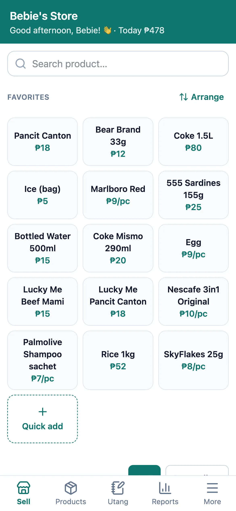
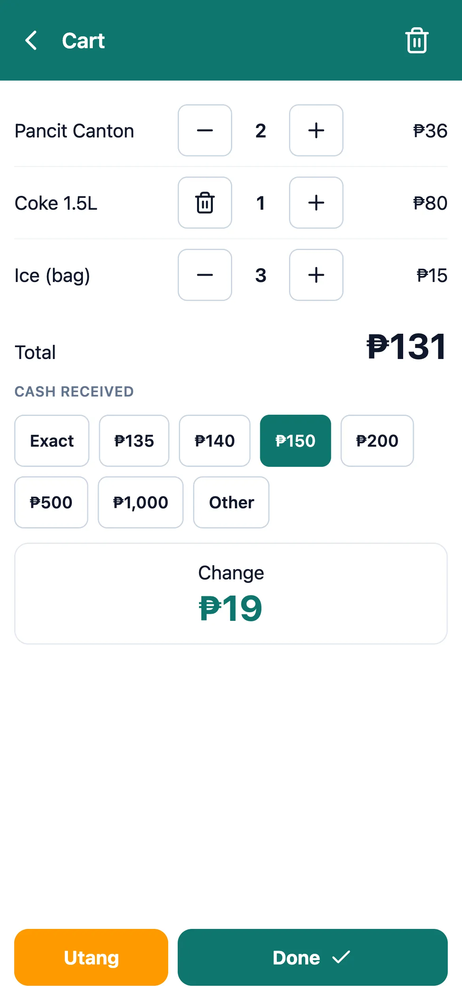
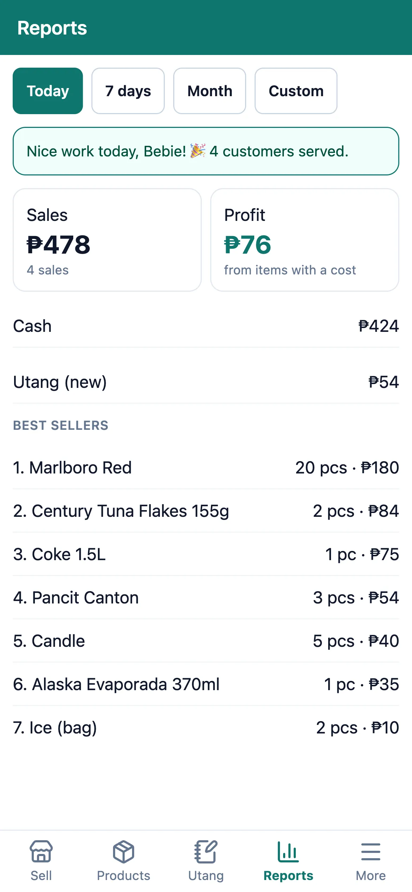
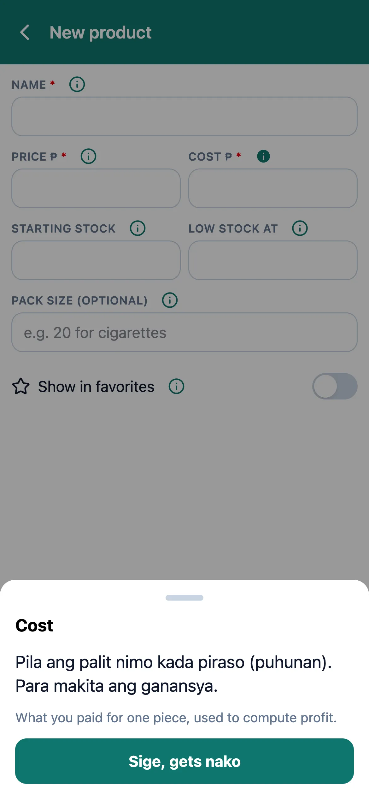
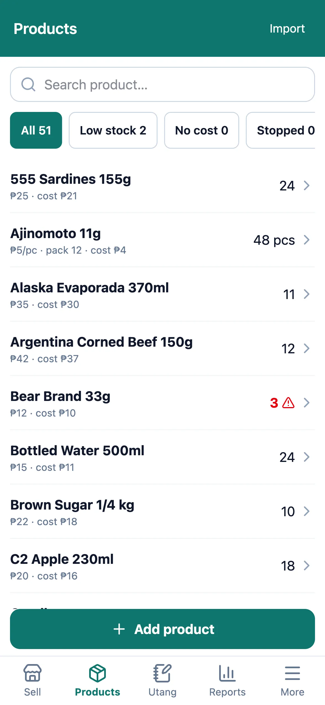
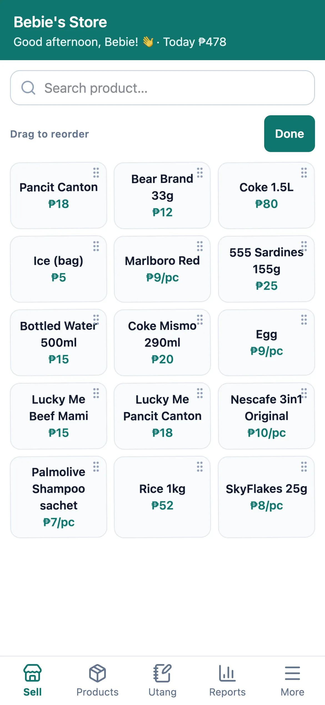

# Bebie's Store

An offline point-of-sale app for my family's sari-sari store, built for one very specific user: my mom, whose nickname is **Bebie**. It's designed around how she works: one Android phone at the counter, no reliable internet, customers paying with whatever bills they have, and a notebook full of utang (credit). I use it myself too.

**Live:** [bebie-store.vercel.app](https://bebie-store.vercel.app) · installable on Android as an app · works with no internet

<p>
  
  
  
  
</p>

## What version 1 does

| Area                 | What it does                                                                                                                                                                                                                             |
| -------------------- | ---------------------------------------------------------------------------------------------------------------------------------------------------------------------------------------------------------------------------------------- |
| **Sell**             | Favorites grid for one-tap selling, a full product list sortable **A–Z** or by **Best sellers** (last 30 days), and search. Products sell by **piece or pack** (a cigarette stick or a pack of 20, coffee by sachet or by strip).        |
| **Checkout**         | **Smart cash buttons**: for a ₱75 total it suggests ₱80, ₱90 (₱50 + ₱20 + ₱20), ₱100, ₱200… so she rarely types an amount. Shows the change in large text. **Cash or Utang.** Double-tap safe.                                           |
| **Utang**            | Customer list with balances and how long each has been owed, partial payments, and a full credit/payment history per customer.                                                                                                           |
| **Products & stock** | Add or edit products, restock by piece or pack (with automatic cost per piece), stock adjustments with a reason (spoiled, missing, recount, family use), low-stock alerts, and a CSV import for setting up hundreds of products at once. |
| **Reports**          | Sales, profit, cash vs. utang, and best sellers for today, 7 days, this month or a custom range.                                                                                                                                         |
| **Backup**           | One tap creates a backup file and opens Android's share sheet, so she sends it to me on Messenger. Restore validates the file completely before replacing anything.                                                                      |
| **Made for her**     | Her name on the app and in greetings, **Bisaya + English help** on every product field, big tap targets, a drag-to-arrange favorites grid, and nothing she has to set up.                                                                |

<p>
  
  
  
</p>

## Design decisions and why

**Offline-first, data on the phone.** The counter has no reliable internet, and a POS that stops working when the signal drops is worse than a notebook. The app is a PWA: all data lives in the phone's IndexedDB (via Dexie), and Vercel only serves the app's files. The store's data never leaves the phone except as a backup file she chooses to send.

**Money is always whole centavos.** ₱12.50 is stored as `1250`. Floating-point pesos eventually produce totals like ₱12.499999. The input parser also rejects `1,5` instead of reading it as ₱15.

**Every save is all-or-nothing.** A checkout writes the sale, its items, the stock changes and the counts in one transaction. If anything fails, nothing is saved, so stock can never drift from sales.

**Stock is a running count plus a full history.** Every change (sale, void, restock, adjustment) is a stock move with a reason. A test checks that the count always equals the sum of its history, and the restore check rejects any backup where they disagree.

**Sales remember their price and cost.** Each sale copies the price and cost at the moment of selling. When a supplier raises prices next month, last month's profit doesn't silently change.

**The backup file is the migration path.** It's a versioned JSON format (`formatVersion: 1`) with every table, unique ids and reference checks. That's how the data will move to version 2.

**No receipts, on purpose.** In the Philippines, a POS that issues official receipts needs BIR registration. The store uses paper invoices instead, so the app stays a private tracking tool. That keeps it simple and legal.

**Cost is required.** It started optional so setup would be fast, but my mom knows her costs, and optional cost meant "profit unknown" on some sales. Required cost keeps every report complete.

**Help in her language.** Each product field has an ⓘ that opens a large bottom sheet explaining it in Bisaya with English underneath, with a big "Sige, gets nako" button to close. A popover was tried first, and a sheet turned out easier for her to read and dismiss.

## Tech stack

React 19 · TypeScript · Vite · Tailwind CSS 4 · vite-plugin-pwa (Workbox) · Dexie (IndexedDB) · wouter · dnd-kit · Papa Parse · Lucide icons · Vitest + fake-indexeddb + Testing Library · oxlint · Prettier · Vercel

About 220 tests cover the money parsing, cart and cash suggestions, every database operation (including rollback on failure), backup round trips and tampered-file rejection, and the main screen flows.

## Project structure

```
src/
  money.ts          pesos ↔ centavos, formatting
  db.ts             Dexie schema and row types
  domain/           pure logic: cart, cash suggestions, dates, reports, sorting
  data/             every database write, each in one transaction
  screens/          one file per screen, plus screen tests
  ui.tsx            shared components (Screen, Sheet, Field, Stepper…)
```

Screens never write to the database directly. They call `data/` functions, so all the rules live in one tested place.

## Run it locally

```bash
npm install
npm run dev        # http://localhost:5173 (also on your LAN for phone testing)
npm test           # run the test suite
npm run check      # typecheck, lint, format check and tests
npm run build      # production build with service worker
```

A sample product list for trying the CSV import is in [`public/sample-products.csv`](public/sample-products.csv).

## What's next

Some ideas for future versions, if the store grows:

- **Version 2: a laptop at the counter.** A small Hono + SQLite server on a Windows laptop, packaged as a single `.exe` with Bun. The phone and the laptop share one database over Wi-Fi. The existing backup file imports straight into it.
- **Barcode scanning.** USB scanners type like a keyboard, so this fits the existing search and checkout.
- **Categories** (drinks, snacks, toiletries…) for browsing and for profit by category.
- **Remote view of sales**, so I can check the store from wherever I am without waiting for a backup file.
- **Order slips** from a thermal printer, clearly marked "not an official receipt".
- **GCash payments** alongside cash and utang.

## How it was built

I designed and built this with [Claude Code](https://claude.com/claude-code) as a pair. Every feature went through the same loop: talk through the problem (often from my mom's point of view), agree on a written design, write a step-by-step plan, then implement with tests first, independent code review per task and a final whole-branch review. Every UI change was also checked in a phone-sized browser before deploying. The commits credit Claude as co-author.

## License

[MIT](LICENSE)
